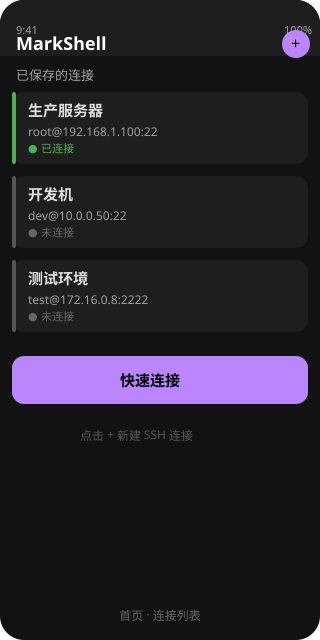
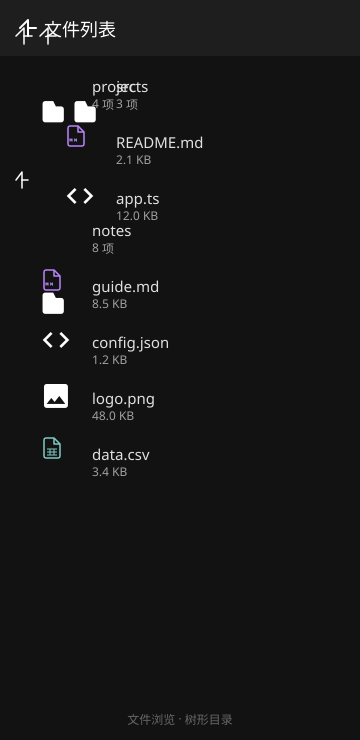
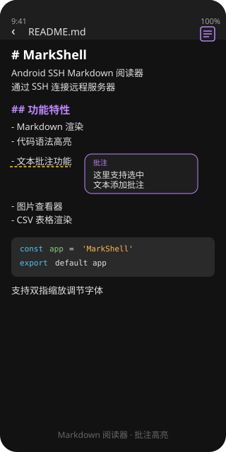
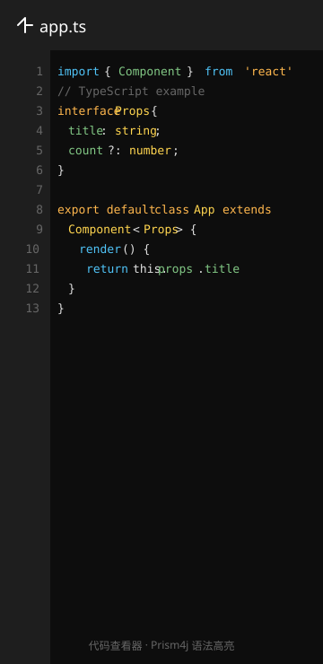

<div align="center">

# MarkShell

<p>
  
</p>

### Android SSH Markdown 阅读器

**随时随地，直连你的服务器，像读本地文件一样读远程 Markdown。**

通过 SSH/SFTP 安全连接远程主机，在手机上浏览目录、阅读与编辑 Markdown / 代码 / 日志，边读边批注——无需下载同步，不改动服务器任何内容。

<p>
  
  
  
  
  
</p>

</div>

---

## 为什么选 MarkShell

**不是又一个文件管理器，而是装在手机里的 SSH 工作台。**

| 核心竞争力 | 说明 |
|---|---|
| 🔐 **直连，零同步** | 所有文件经 SSH/SFTP 直接读写，不缓存、不改服务器，改动即时落盘 |
| ✍️ **阅读 + 批注 + 在线编辑** | 阅读态选中即批注（存 CSV 不动原文），随时切编辑保存，草稿自动恢复 |
| 🌐 **运维级文件支持** | 自动识别并直接打开 sshd_config、systemd unit、apt 源、sudoers 等上百种无扩展名/配置类文件，告别"暂不支持" |
| 🖥️ **专业阅读体验** | 代码高亮、大纲、查找、跨会话续读、双指缩放，大屏两栏预览 |
| 🧰 **完整 SSH 能力** | 多服务器、密钥认证、端口转发、连接保活、Keystore 加密凭据 |

**适合谁**：运维 / 后端 / 需要随手读服务器文档、日志、配制的开发者——把"要开电脑拉文件"变成"掏出手机就看"。

---

## 核心功能

### 连接与安全
多服务器配置 · 快速重连 · 网络切换自动恢复 · 凭据 AES-256-GCM + Keystore 加密 · 密钥认证 · 指纹校验 · 端口转发

### 远程文件
树形目录 · 类型图标 · 全局递归搜索 · 书签/最近打开 · 上传/下载（SAF 流式） · 重命名/移动/复制/权限（多选批量）

### 阅读与批注
Markdown 渲染（GFM · 任务清单 · 代码高亮） · 选中即批注（CSV 存储 · 原文零改动） · 代码/文本/图片/CSV 查看器 · 查找 · 续读 · 缩放

### 在线编辑
单页切换阅读/编辑 · 保存写回 SFTP · 草稿恢复 · 格式工具栏 · 查找替换 · 撤销重做

---

## 界面预览

<div align="center">
<table>
<tr>
<td align="center"><br/>首页 · 连接列表</td>
<td align="center"><br/>文件浏览 · 树形目录</td>
</tr>
<tr>
<td align="center"><br/>Markdown 阅读器 · 批注高亮</td>
<td align="center"><br/>代码查看器 · 语法高亮</td>
</tr>
</table>
</div>

---

## 技术栈

| 库 | 版本 | 用途 |
|---|---|---|
| [JSch](http://www.jcraft.com/jsch/) | 0.1.55 | SSH/SFTP 连接 |
| [Markwon](https://github.com/noties/markwon) | 4.6.2 | Markdown 渲染 |
| [Prism4j](https://github.com/noties/prism4j) | 2.0.0 | 代码语法高亮 |
| [Material Design](https://material.io/develop/android) | 1.11.0 | UI 组件 |
| [AndroidX](https://developer.android.com/jetpack/androidx) | — | 基础库 |

## 项目结构

```
app/src/main/java/com/ssh/mdreader/
├── ui/               # Activity
├── ssh/              # SSH 管理器（连接/断连/读写/重连/密钥/指纹/转发）
├── model/            # 数据模型
├── adapter/          # RecyclerView 适配器
├── util/             # 工具层（多数纯函数可 JVM 测）
├── widget/           # 自定义 View
└── ui/span/          # 自定义 Span
```

## 批注系统

批注采用**渲染后文本搜索 + 出现序号**方案：

```
用户选中文本 → 记录 occurrenceIndex → 写入 CSV → 渲染后按序号 setSpan
```

| 特性 | 说明 |
|---|---|
| Markdown 源文件零修改 | 批注只存 CSV，不向 Markdown 插入任何标签 |
| 重复文本消歧 | `occurrenceIndex` 记录被批注文本是第几次出现（0-based） |
| 渲染流程 | Markwon 正常渲染 → `findNthOccurrence()` 定位 → `setSpan()` |

## 构建

```bash
# 需要 JDK 17 和 Android SDK
export JAVA_HOME=$(/usr/libexec/java_home -v 17)
export ANDROID_HOME=~/Library/Android/sdk
cd ssh-md-reader && gradle assembleDebug
```

## 系统要求

- Android 7.0 (API 24) 及以上
- targetSdk 34

## License

[MIT](LICENSE)
